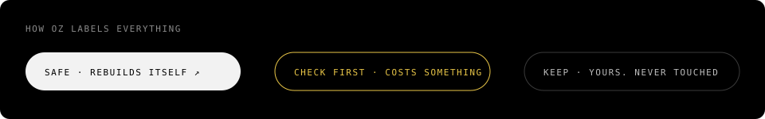

<div align="center">



<br>

# Oz Cleaner
<sub>BY <b>OZ STUDIOS</b></sub>

## Your drive is full of junk. Oz knows which junk.

**A Windows storage and system toolbox that shows its work.**<br>
See what fills a drive. Clean what rebuilds itself. Remove the bloat. Undo all of it.

<br>


<sub><a href="#00--the-pitch">PITCH</a> &nbsp;·&nbsp; <a href="#01--three-jobs-one-app">FEATURES</a> &nbsp;·&nbsp; <a href="#02--the-rules">RULES</a> &nbsp;·&nbsp; <a href="#03--under-the-hood">ARCHITECTURE</a> &nbsp;·&nbsp; <a href="#04--where-it-stands">ROADMAP</a> &nbsp;·&nbsp; <a href="#05--questions-you-might-have">FAQ</a></sub>

</div>

<br>

---

### 00 — THE PITCH

Most cleaners are confident and wrong. They wave a big red number at you, delete a folder you needed, and call it optimisation.

Oz is the opposite: **a cautious nerd with a treemap**. Every file it proposes says:

> **why** it matched &nbsp;·&nbsp; **what** regenerates it &nbsp;·&nbsp; **what** you lose if it goes

If Oz isn't sure, it says *estimated*, *likely* or *not recognised*. If it can't vouch for something, the answer is **Keep**. No scare numbers, no fake progress bars, no "your PC is at risk!!".



<sub>Illustration, not a real run. In the app, every number on screen comes from a real measurement; this one is a <code>[placeholder]</code>.</sub>

---

### 01 — THREE JOBS, ONE APP


<details open>
<summary><b>🔍 &nbsp;EXPLORE</b> &nbsp;—&nbsp; see what fills a drive, fast</summary>
<br>

| | |
|---|---|
| **Fast scan** | reads the NTFS Master File Table directly, through an elevated helper that can only *read* |
| **Standard scan** | a plain directory walk with no elevation, for when you'd rather not |
| **Map** | hand-written WebGL2 treemap. Big box, big folder. Click to dive |
| **Strata** | depth icicle: how deep the nesting goes |
| **Timeline** | age grid: what you haven't touched since forever |
| **Lenses** | temporary colour encodings layered on a view |
| **Unaccounted** | volume used minus scanned total, shown honestly instead of swept under the rug |

Long paths (way past 260), Unicode names, junctions and hard links are treated as normal cases, because on a real Windows machine they are.

</details>

<details>
<summary><b>🧹 &nbsp;CLEAN</b> &nbsp;—&nbsp; caches, temp and leftovers, AI and dev tools included</summary>
<br>

Covers the usual Windows temp and caches, plus what modern machines actually hoard: **Claude Code, Codex, ChatGPT, npm, pip** and friends.

Each tool's folder is split down the middle:

```text
 some-ai-tool/
 ├─ cache/          →  SAFE         rebuilds itself
 ├─ logs/           →  CHECK FIRST  costs you some history
 ├─ chats/          →  KEEP         your data
 ├─ settings.json   →  KEEP         your data
 └─ credentials     →  KEEP         absolutely your data
```



- Nothing goes straight to oblivion. Files move to the **Holding Area** (`X:\OzHold\`) on the same volume, restorable.
- **Reclaim** is a staging list. You see the whole plan before anything moves.
- A rule ships only with a verified date, Windows build, method, and a test. Popularity on cleanup blogs isn't evidence.



</details>

<details>
<summary><b>🧰 &nbsp;DEBLOAT</b> &nbsp;—&nbsp; 77 catalogued Windows tweaks, every one reversible</summary>
<br>

The **Tweaks** catalog (`crates/oz-tweaks/catalog.toml`) has **77** entries today. Each one shows its live state on your machine, and each can be undone.

| Category | Tweaks | | Tier | Tweaks |
|---|:---:|---|---|:---:|
| Privacy | 31 | | **Recommended** | 21 |
| Performance | 17 | | **Optional** | 56 |
| Taskbar | 14 | | | |
| Explorer | 11 | | **Scope** | |
| Accessibility | 3 | | per-user (HKCU, power plan) | 70 |
| Storage | 1 | | machine-wide (HKLM, needs admin) | 7 |

Examples: no ads or suggestions in Start, no tips nags, Copilot off, file extensions shown, taskbar icons on the left, Game Mode, hardware-accelerated GPU scheduling.

**How a tweak gets applied**

- **Per-user** tweaks (your `HKCU` values and the active power plan) are written by the app itself. The prior value is saved first, so Undo puts back exactly what was there.
- **Machine-wide** tweaks (`HKLM`, power settings) go through the elevated helper, which only knows two fixed operations: `TWEAK_APPLY` and `TWEAK_REVERT`. Both take a **catalog id**, never a registry path or a command.
- Only documented Microsoft mechanisms. Each catalog entry lists its exact key and value, its tier, whether it needs a restart, and its evidence.
- Tiered **Recommended**, **Optional**, **Explain only**. No mystery "apply everything" button: you see every change before it happens.
- A System Restore point is offered before each batch. One-click **Undo all**, always.

<sub>Coming next: removing preinstalled apps (`Remove-AppxPackage`, current user) and optional features. Not in the catalog yet.</sub>



</details>

<details>
<summary><b>🗑️ &nbsp;UNINSTALL A → Z</b> &nbsp;—&nbsp; the app, then everything it left behind</summary>
<br>

1. The app's own uninstaller runs first. Never forced. If it fails, Oz stops and tells you.
2. Then the leftover hunt: install folder, `AppData` (Roaming, Local, LocalLow), `ProgramData`, shortcuts, uninstall and `Software\<Publisher>\<App>` keys, scheduled tasks, services that lived in the install folder.
3. Every leftover shows its evidence:

| Confidence | Means | Preselected |
|---|---|:---:|
| **Certain** | inside the recorded install location, or named by the uninstall record | ✓ |
| **Likely** | publisher *and* app name match | — |
| **Name only** | just the name | never |

Folders shared with another installed app from the same publisher are flagged and left unticked. Registry keys are exported to the Ledger before removal. Documents, saves and Pictures are **Keep**. Nothing under `Windows`, `System32` or `WinSxS` is ever proposed.

</details>

<details>
<summary><b>📦 &nbsp;RELOCATE</b> &nbsp;—&nbsp; move a big folder, keep the path working</summary>
<br>

A verified copy to another drive, then a junction in the old spot, so the app using it keeps working. Recorded in the Ledger like everything else.

</details>

---

### 02 — THE RULES

Oz has a short list of things it will **never** do. These aren't settings. They're load-bearing walls.

```diff
- touch Defender, SmartScreen, Firewall, UAC, Windows Update, BitLocker, Secure Boot or System Restore
- take ownership, change ACLs, kill processes, force an uninstall
- remove apps Windows marks non-removable
- run a downloaded script. No `irm … | iex`. Ever.
- activate Windows or Office, emulate KMS, or change a product key
- write to a raw volume handle
- elevate the UI. The helper accepts a fixed enum of operations, never a command string
- phone home. No network calls, no telemetry. Your file paths stay on your machine
- recommend your files for deletion because of their name, age or type
- write to the registry outside the catalog. No arbitrary keys, ever
- run cleaning or debloat experiments on a real system. Destructive tests live in a VM, Sandbox or fixture drive
```

```diff
+ show why every item matched, with a confidence level
+ write only the exact key and value a tweak's catalog entry lists
+ save the prior value (or its absence) before every write
+ apply machine-wide tweaks only through the helper, by catalog id
+ offer a restore point before a batch, and Undo for every batch
+ say "not sure" when it's not sure
```

<details>
<summary><b>THE TWEAK GATE</b> &nbsp;·&nbsp; what a tweak needs before it ships</summary>
<br>

| Every tweak | Per-user (HKCU, power plan) | Machine-wide (HKLM, power settings) |
|---|---|---|
| documented Microsoft mechanism | ✓ | ✓ |
| catalog entry: exact targets, apply, revert, builds, `verified` | ✓ | ✓ |
| prior value saved, working Undo | ✓ | ✓ |
| tier: Recommended / Optional / Explain only | ✓ | ✓ |
| applied by | the app | the elevated helper, by id |
| Sandbox apply → revert → compare test | wanted | wanted, added when Sandbox is available |

The write-and-undo mechanism itself is tested on an app-owned scratch key. Security and update settings are off the table for every tier.

</details>

<details>
<summary><b>THE CLEANING GATE</b> &nbsp;·&nbsp; what a cleaning rule needs before it ships</summary>
<br>

1. The path exists and holds what it claims.
2. What regenerates it, and what losing it costs, is confirmed from vendor docs or a controlled test.
3. `verified` is filled in: date, Windows build, method.
4. A test exists.

Unsure? It becomes **Keep** and Oz only explains it.

</details>

And one more: Oz is **not an app installer**. It removes; it doesn't fetch.

---

### 03 — UNDER THE HOOD

```text
┌──────────────────────────────┐          ┌──────────────────────────────┐
│  oz-cleaner.exe   (you)      │   enum   │  oz-helper.exe   (elevated)  │
│  React + TypeScript UI       │ ───────▶ │  fixed, named operations     │
│  WebGL2 treemap              │ ◀─────── │  read-only MFT reader        │
│  Tauri 2 shell               │  results │  no strings, no scripts      │
└───────────────┬──────────────┘          └───────────────┬──────────────┘
                └──────────────── Rust core ──────────────┘
    oz-model · oz-ntfs · oz-layout · oz-rules · oz-ops · oz-tweaks
                 oz-win  ← every FFI call and every `unsafe` lives here
```

**Why it's built this way**

- **Two processes.** The UI never elevates. The helper only understands a closed list of operations, so a bug in the UI can't become "run anything as admin".
- **Bulk data stays in Rust.** Millions of file records never cross into JavaScript. The UI asks only for what's on screen, keeping the 16 ms frame budget.
- **One crate owns the dangerous bits.** All Windows FFI is in `oz-win`. `unsafe` appears nowhere else.
- **The parser never panics on input.** A corrupt MFT record is a skipped record, not a crash.

<details>
<summary><b>REPO MAP</b></summary>
<br>

| Path | Holds |
|---|---|
| `apps/desktop` | Tauri app: React UI and its Rust backend |
| `apps/helper` | `oz-helper.exe`, the elevated process |
| `crates/oz-win` | every Windows API call |
| `crates/oz-ntfs` | MFT parser |
| `crates/oz-model` | the in-memory file index |
| `crates/oz-layout` | treemap layout |
| `crates/oz-rules` | cleaning catalog (`catalog.toml`) |
| `crates/oz-tweaks` | debloat catalog and logic, pure |
| `crates/oz-ops` | plans, guard, Ledger, Holding Area, Relocate |
| `tools/` | fixture builders |

</details>

<details>
<summary><b>DESIGN — OZ INK</b></summary>
<br>

Pure black. Strictly monochrome. Editorial, like a well-set magazine that happens to delete things.

| Token | Value | Role |
|---|---|---|
| text 1 | `#f2f2f2` | headings, numbers |
| text 2 | `#bdbdbd` | body |
| text 3 | `#8a8a8a` | captions |
| text 4 | `#3a3a3a` | quiet |
| hairline | `#1f1f1f` | dividers |
| signal | yellow | caution only |
| danger | red | irreversible only |

**Bricolage Grotesque** for words, weights 200 against 800. **JetBrains Mono** for paths, labels and numbers, always tabular. The primary action is a white pill with ↗. Motion honours Full / Reduced / Off.

</details>

<details>
<summary><b>BUILD FROM SOURCE</b></summary>
<br>

Needs Rust stable (MSVC toolchain), Node, and the Tauri 2 prerequisites.

```bash
cargo fmt --check
```

```bash
cargo clippy --workspace -- -D warnings
```

```bash
cargo test --workspace
```

Build the helper, then the app and its installer:

```bash
cargo build --release -p oz-helper
```

```bash
cd apps/desktop && npm ci && npx tauri build
```

The installer lands in `target/release/bundle/nsis/`. The portable app is `target/release/oz-cleaner.exe`; keep `oz-helper.exe` in the same folder.

Destructive tests run only against the fixture VHDX, a scratch folder the test makes, or a disposable VM / Windows Sandbox. Never a real system.

</details>

---

### 04 — WHERE IT STANDS

The honest version: code for M1–M6b exists and builds into a working app and installer, but **no milestone exit check is recorded as run yet**. Done: Explore, Clean, 77 tweaks with live state and Undo (machine-wide ones through the elevated helper), Uninstall A to Z with leftover finding, and removal of built-in apps. A milestone counts as done only when every exit check has actually been run.

| | Milestone | Status |
|---|---|:---:|
| M0 | Foundations and spikes | `TODO` |
| M1 | Design system, shell, Standard scan | `TODO` |
| M2 | Fast scan | `TODO` |
| M3 | Atlas | `TODO` |
| M4 | Full analysis, first usable release | `TODO` |
| M5 | Understanding and cleaning | `TODO` |
| M6 | Relocate and uninstall helper | `TODO` |
| M6b | Debloat | `IN PROGRESS` |
| M7 | Memory and refinement | `TODO` |
| M8 | Ship 1.0 | `TODO` |

Live state: [`04-ROADMAP.md`](04-ROADMAP.md).

---

### 05 — QUESTIONS YOU MIGHT HAVE

<details>
<summary><b>How much space will it free?</b></summary>
<br>
No idea, and neither does anyone who answers that before scanning your machine. Oz shows what it measured, nothing more.
</details>

<details>
<summary><b>Will it delete my Claude / ChatGPT / Codex chats?</b></summary>
<br>
No. Chats, settings, memory and credentials of AI tools are personal data and always <b>Keep</b>. Only their caches can be Safe.
</details>

<details>
<summary><b>Why does it need admin?</b></summary>
<br>
It doesn't, unless you choose Fast scan or one of the 7 machine-wide tweaks. Per-user tweaks need no admin at all. Even then only the small helper elevates, and it only speaks a fixed list of operations. The window you click on never runs as admin.
</details>

<details>
<summary><b>Can it turn off Windows Update or Defender?</b></summary>
<br>
No, by design. Oz never touches security or update settings.
</details>

<details>
<summary><b>Can it activate Windows?</b></summary>
<br>
No. No activation scripts, no KMS, no key changes.
</details>

<details>
<summary><b>I removed something and want it back.</b></summary>
<br>
Files sit in the Holding Area, tweaks have a recorded revert, and registry keys are exported before removal. <b>History</b> lists every operation with an Undo.
</details>

<details>
<summary><b>Is it like WizTree?</b></summary>
<br>
Same spirit for the Explore part (fast MFT scan, treemap), but its own code, look and name. Then it keeps going into cleaning and debloat.
</details>

---

### 06 — GLOSSARY

| Term | Meaning |
|---|---|
| **MFT** | NTFS Master File Table, one record per file |
| **Helper** | `oz-helper.exe`, the only elevated process |
| **Atlas** | the Explore workspace: tree, map, types |
| **Lens** | temporary colour encoding on a view |
| **Reclaim** | staging list before any cleaning |
| **Holding Area** | restorable same-volume move, `X:\OzHold\` |
| **Relocate** | verified copy plus junction |
| **Tweak** | one catalogued, reversible debloat change |
| **Ledger** | log of every operation and prior state |
| **Unaccounted** | volume used minus scanned total |

---

### 07 — READ NEXT

| | |
|---|---|
| [`AGENTS.md`](AGENTS.md) | the rules. Safety wins every argument |
| [`01-PRODUCT-VISION`](01-PRODUCT-VISION.md) | why, and the design language |
| [`02-FEATURE-SPEC`](02-FEATURE-SPEC.md) | what, by F-ID |
| [`03-ARCHITECTURE`](03-ARCHITECTURE.md) | how, by decision |
| [`04-ROADMAP`](04-ROADMAP.md) | where it stands |
| [`LICENSE`](LICENSE) | MIT. Use it, fork it, keep the notice |

<br>

<div align="center">

```text
 ██████  ███████
██    ██    ███
██    ██   ███
██    ██  ███
 ██████  ███████   — CLEANER
```

</div>

<br>



<div align="center">

<br>

**Oz Cleaner** is made by **[Oz Studios](https://zaber.tech)** &nbsp;·&nbsp; founded by **Osayeed Zaber**

<sub>© 2026 OSAYEED ZABER &nbsp;·&nbsp; MIT LICENSE &nbsp;·&nbsp; MADE WITH TOO MUCH BLACK</sub>

</div>
